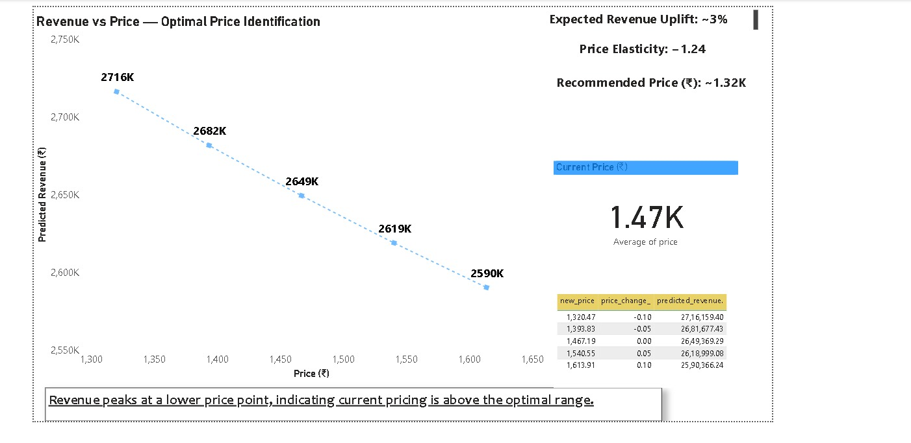

# AI-Driven Pricing Optimization (D2C)

**Is the current price leaving revenue on the table?** A price-elasticity model and scenario simulation for a direct-to-consumer product, with a Power BI dashboard for the pricing decision.



## Result

| | |
|---|---|
| **Price elasticity of demand** | **−1.24** (elastic: demand moves more than price) |
| **Current average price** | ₹1,467 |
| **Recommended price** | ~₹1,320 (10% lower) |
| **Projected revenue impact** | ~+2.5% to 3% (₹26.5 lakh → ₹27.2 lakh per day) |

Because demand is elastic, a lower price sells enough extra units to more than make up for the lower margin per unit.

## Business problem

Pricing in D2C businesses is often set by intuition. This project tests whether the current price maximises revenue, and by how much revenue would change if the price moved up or down.

## Approach

1. **Data:** 200 daily observations (2024) of price, units sold, promotion flag and revenue.
2. **Model:** log-log linear regression of units sold on price, so the price coefficient is the elasticity directly.
3. **Control for promotions:** a price-only model gives an elasticity of −1.82, which overstates price sensitivity because promotions happen on low-price days. Adding the promotion flag as a control gives **−1.24**, the figure used for the recommendation.
4. **Scenario simulation:** predicted demand and revenue at −10%, −5%, 0%, +5% and +10% price changes.
5. **Dashboard:** Power BI view of the scenarios for decision-makers.

## Scenario results

| Price change | Price (₹) | Predicted units/day | Predicted revenue/day (₹) |
|---|---|---|---|
| **−10%** | **1,320** | **2,057** | **27,16,159** |
| −5% | 1,394 | 1,924 | 26,81,677 |
| 0% (current) | 1,467 | 1,806 | 26,49,369 |
| +5% | 1,541 | 1,700 | 26,18,999 |
| +10% | 1,614 | 1,605 | 25,90,366 |

## Recommendation and caveats

- Test a price near ₹1,320 with a controlled experiment before a full rollout.
- The model looks at revenue, not profit. A margin check is needed before cutting price.
- Elasticity is estimated within the observed price range (₹1,230 to ₹1,650) and should not be extrapolated far beyond it.

## Files

| File | Purpose |
|---|---|
| `pricing_elasticity_model.ipynb` | Elasticity model and scenario simulation |
| `d2c_pricing_data.csv` | Daily price, units, promotion and revenue data |
| `pricing_simulation.csv` | Scenario output used by the dashboard |
| `dashboard_preview.jpeg` | Power BI dashboard screenshot |

## How to run

```bash
pip install pandas numpy scikit-learn matplotlib jupyter
jupyter notebook pricing_elasticity_model.ipynb
```

## Tools

Python (Pandas, NumPy, scikit-learn) · Power BI

---

**Arpit Kalwar** · [LinkedIn](https://www.linkedin.com/in/arpit-kalwar) · [More projects](https://github.com/kalwararpit)
